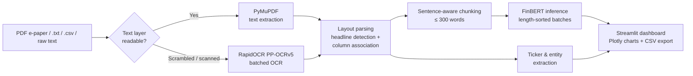

<h1 align="center">📈 Financial Sentiment & Market Impact Dashboard</h1>

<p align="center">
  <b>An end-to-end NLP + Computer Vision pipeline that extracts, parses and scores financial news<br>from full-page e-papers, text files or raw headlines.</b>
</p>

<p align="center">
  
  
  
  
  
</p>

<p align="center">
  
  
  
</p>

<p align="center">
  <a href="#-features">Features</a> •
  <a href="#-how-it-works">How It Works</a> •
  <a href="#-supported-inputs">Supported Inputs</a> •
  <a href="#-dashboard-analytics">Analytics</a> •
  <a href="#-tech-stack">Tech Stack</a> •
  <a href="#-getting-started">Getting Started</a>
</p>

<!-- Add a screenshot of the dashboard here once you have one:
<p align="center">
  
</p>
-->

<p>
Built with <b>Streamlit</b>, <b>FinBERT</b>, <b>PyMuPDF</b> and <b>RapidOCR</b>, this tool handles complex multi-column newspaper layouts and scrambled text layers to measure <b>aggregate market mood</b> and <b>entity-level sentiment</b>.
</p>

<br>

## ✨ Features

<table>
  <tr>
    <td width="50%" valign="top">
      <h3>📥 Multi-Source Ingestion</h3>
      <ul>
        <li>PDF e-papers — both digital and scrambled / scanned</li>
        <li><code>.txt</code> headline dumps</li>
        <li><code>.csv</code> article datasets</li>
        <li>Manual single-headline testing</li>
      </ul>
    </td>
    <td width="50%" valign="top">
      <h3>📰 Robust e-Paper Layout Parsing</h3>
      <ul>
        <li>Detects scrambled or corrupted PDF text layers with a PyMuPDF fast scan (<b>~0.3 s for 42 pages</b>)</li>
        <li>Falls back to <b>RapidOCR (PP-OCRv5)</b> with custom batching for scanned or scrambled pages</li>
        <li>Smart headline detection using font height ratios (<b>≥ 1.28× body text height</b>)</li>
        <li>Column-aware bounding-box association</li>
        <li>Ignores running headers, footers, stock price tables and captions</li>
      </ul>
    </td>
  </tr>
  <tr>
    <td width="50%" valign="top">
      <h3>⚡ Optimized FinBERT Inference</h3>
      <ul>
        <li><code>ProsusAI/finbert</code>, fine-tuned for 3-class financial sentiment: <i>positive</i>, <i>negative</i>, <i>neutral</i></li>
        <li>Sentence-aware chunking (<b>≤ 300 words</b>) to avoid truncation within the 512-token limit</li>
        <li>Length-sorted mini-batching (default batch size <b>16</b>) under <code>torch.no_grad()</code> on CPU</li>
        <li>Cached model loading via <code>@st.cache_resource</code></li>
      </ul>
    </td>
    <td width="50%" valign="top">
      <h3>🏷️ Ticker & Entity Extraction</h3>
      <ul>
        <li>Pattern matching across <b>68 watchlist symbols</b> — US & Indian equities plus indices like NIFTY, BANKNIFTY, SENSEX and NASDAQ</li>
        <li><b>72 company-to-ticker</b> mappings</li>
        <li>Supports cashtags (<code>$TSLA</code>), exchange prefixes (<code>NSE:TCS</code>), capitalized watchlist symbols and full company names</li>
      </ul>
    </td>
  </tr>
  <tr>
    <td colspan="2" valign="top">
      <h3>📊 Interactive Analytics</h3>
      <ul>
        <li>Real-time market mood indicator — <b>Bullish %</b> (excluding neutral coverage) and <b>Net Impact Score</b></li>
        <li>Interactive Plotly visualizations: sentiment distribution donuts, per-ticker sentiment breakdowns and top-impact headline tables</li>
        <li>Bounding-box overlay toggle to inspect detected newspaper regions</li>
        <li>Single-click CSV export → <code>finbert_daily_sentiment.csv</code></li>
      </ul>
    </td>
  </tr>
</table>

<br>

## 🧠 How It Works



<details>
<summary><b>Headline detection details</b></summary>
<br>
<ul>
  <li>The median body-text height on each page is used as the baseline.</li>
  <li>Text spans whose font height is at least <b>1.28×</b> that baseline are treated as headline candidates.</li>
  <li>Each headline is linked to the body text beneath it within the same column, using bounding-box geometry.</li>
  <li>Repeating page furniture (running headers, footers), numeric stock tables and image captions are filtered out before scoring.</li>
</ul>
</details>

<br>

## 📂 Supported Inputs

<table>
  <thead>
    <tr>
      <th align="left">Source</th>
      <th align="left">Format</th>
      <th align="left">Handling</th>
    </tr>
  </thead>
  <tbody>
    <tr>
      <td>Digital e-paper</td>
      <td><code>.pdf</code></td>
      <td>Direct PyMuPDF extraction with layout parsing</td>
    </tr>
    <tr>
      <td>Scanned / scrambled e-paper</td>
      <td><code>.pdf</code></td>
      <td>Auto-detected, routed to batched RapidOCR</td>
    </tr>
    <tr>
      <td>Headline dump</td>
      <td><code>.txt</code></td>
      <td>One headline per line</td>
    </tr>
    <tr>
      <td>Article dataset</td>
      <td><code>.csv</code></td>
      <td>Row-wise article scoring</td>
    </tr>
    <tr>
      <td>Single headline</td>
      <td>Text box</td>
      <td>Instant manual testing</td>
    </tr>
  </tbody>
</table>

<br>

## 📊 Dashboard Analytics

<table>
  <tr>
    <td align="center" width="25%"><b>🟢 Bullish %</b><br><sub>Share of positive coverage, excluding neutral</sub></td>
    <td align="center" width="25%"><b>⚖️ Net Impact Score</b><br><sub>Aggregate market mood across all headlines</sub></td>
    <td align="center" width="25%"><b>🍩 Sentiment Donuts</b><br><sub>Positive / negative / neutral distribution</sub></td>
    <td align="center" width="25%"><b>🏷️ Per-Ticker View</b><br><sub>Sentiment breakdown for each detected symbol</sub></td>
  </tr>
</table>

<br>

## 🧰 Tech Stack

<table>
  <tr>
    <td><b>Frontend / UI</b></td>
    <td>Streamlit, Plotly</td>
  </tr>
  <tr>
    <td><b>NLP</b></td>
    <td>FinBERT (<code>ProsusAI/finbert</code>), Hugging Face Transformers, PyTorch</td>
  </tr>
  <tr>
    <td><b>PDF & OCR</b></td>
    <td>PyMuPDF, RapidOCR (PP-OCRv5)</td>
  </tr>
  <tr>
    <td><b>Entity extraction</b></td>
    <td>Regex pattern matching + curated watchlist and company-to-ticker maps</td>
  </tr>
</table>

<br>

## 🚀 Getting Started

```bash
# Clone the repository
git clone https://github.com/<your-username>/<repo-name>.git
cd <repo-name>

# Install dependencies
pip install -r requirements.txt

# Launch the dashboard
streamlit run app.py
```

> [!NOTE]
> On first launch, the FinBERT weights are downloaded from Hugging Face and then cached for later runs.

<br>

<p align="center">
  <sub>Made with ☕ and FinBERT</sub>
</p>
